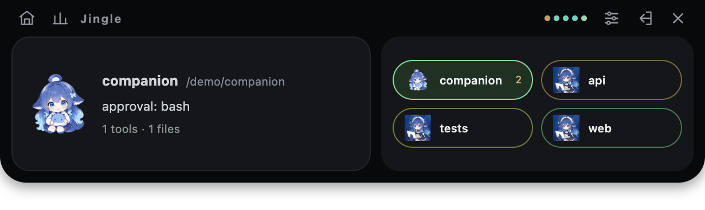
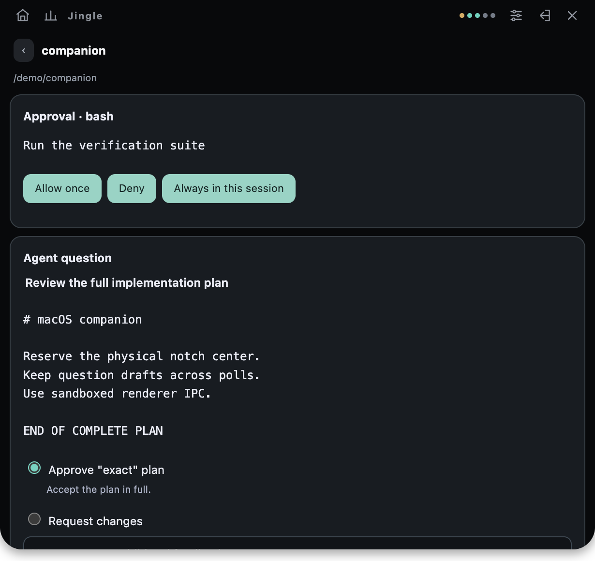

<p align="center">
  
</p>

<h1 align="center">JingleNotch</h1>
<p align="center"><strong>AI Agent Approval Notifier for DeepSeek Harness</strong><br>鲸铃 Jingle · macOS notch companion</p>
<p align="center">
  <a href="https://github.com/5ysy/dsh-jingle-notch">GitHub</a> ·
  <a href="https://www.npmjs.com/package/dsh-jingle-notch">npm</a> ·
  <a href="README.zh.md">中文</a>
</p>
<p align="center">
  <a href="https://www.npmjs.com/package/dsh-jingle-notch"></a>
  <a href="LICENSE"></a>
  
</p>


JingleNotch keeps the moments that need your decision visible while an AI agent works. When DeepSeek Harness pauses for tool approval, a plan review or a structured question, 鲸铃 Jingle brings the request to the macOS notch and lets you respond without leaving your workspace.

It runs with DeepSeek Harness Desktop and Web. The same request controls are available in a focused browser dashboard.

## Quick start

With DeepSeek Harness installed, add the plugin from npm to the profile you use.

### macOS Desktop

Open DeepSeek Harness once to initialize it, then fully quit the application. Run:

```sh
'/Applications/DeepSeek Harness.app/Contents/Resources/runtime/cli/bin/dsh' \
  plugin --profile desktop add dsh-jingle-notch
```

Reopen the app with the plugin enabled. The notch companion starts automatically with the Desktop Host.

### Web

```sh
dsh plugin --profile web add dsh-jingle-notch
dsh web
```

Restart an existing Web server after installation. With the plugin enabled, the overlay starts automatically when the Host starts; visit `/jingle` at your Harness server address for the browser panel.

Desktop and Web use separate profiles; install into each one you use. The native overlay requires macOS and a graphical session. The plugin installs a separate Electron runtime so the Desktop Host can launch the overlay; Web/source Hosts can use a configured Electron executable or the documented npm fallback. See [installation](docs/installation.md).

## Plugin features

- **Approval at a glance** — review a tool, then choose Allow once, Deny or Always in this session.
- **Complete plan review** — read the full plan and its exact approval choices before the agent continues.
- **Structured questions** — answer single choice, multiple choice and free text questions in one form; drafts survive polling.
- **Multi-session awareness** — follow active sessions, current tools, workspaces and parallel calls from one compact notch view.
- **Actionable file activity** — inspect bounded before/after previews with added and removed line counts.
- **Native macOS notch UI** — hover for an overview, expand for details, scroll through sessions and keep the panel available for new requests.
- **Browser dashboard** — answer approvals and questions from `/jingle` when a browser view is more convenient.
- **Local operation** — bundled artwork, no additional model requests and no added telemetry service. Recap history stores numeric aggregates only; see [configuration](docs/configuration.md) for privacy and notification controls.
- **Chimes and system notifications** — get alerts for approvals, questions and completed turns, with separate switches and custom audio support.
- **Jingle character states** — bundled animation responds to idle, thinking, working, attention, finished and error states, including reduced-motion posters.

## See JingleNotch in action





The screenshots use synthetic sessions. The original Jingle animations ship in the package and work offline.

## Compatibility

| Host | Verified release | Coverage |
| --- | --- | --- |
| Official macOS Desktop | `0.2.1-rc.5` | Bundled CLI installation, packaged Host and native overlay |
| Released Web | `0.2.1-rc.5` | Web profile, dashboard and native overlay |
| Source Web | `0.2.2-alpha.2` | Built source Host, dashboard and native overlay |

The plugin declares compatibility with `0.2.1-rc.5` and `0.2.2-alpha.2`. The native overlay requires macOS, a graphical session and an Electron executable. See [installation](docs/installation.md) for Electron configuration and local package installation.

## Commands and configuration

```text
/jingle                  Show JingleNotch status
```

The profile patch row is `jingle-notch`. Full configuration options, storage locations and privacy controls are documented in [configuration](docs/configuration.md). [Development and verification](docs/development.md) covers tests, packaging and the Desktop/Web matrix.

## Development

```sh
pnpm install --frozen-lockfile
pnpm typecheck
pnpm test
pnpm build
npm pack --dry-run
```

## Feedback and contributions

Report bugs and suggest features in [Issues](https://github.com/5ysy/dsh-jingle-notch/issues), or send a pull request. Include your macOS, Harness and plugin versions, Desktop/Web profile and reproduction steps. Remove sensitive content from logs and screenshots. See the [development guide](docs/development.md) for builds, tests and packaging.

## License and acknowledgements

JingleNotch is released under the [MIT License](LICENSE). Third-party copyright and permission notices are included in [THIRD_PARTY_NOTICES.md](THIRD_PARTY_NOTICES.md). Built for [DeepSeek Harness](https://github.com/deepseek-ai/deepseek-harness), with package presentation references from [dsh-pet](https://github.com/PC2005-cloud/dsh-pet) and [dsh-market](https://github.com/dsh-market/dsh-market). 鲸铃 Jingle artwork was supplied by the project author; its checksums and source files are documented in [asset provenance](assets/whale/README.md).
