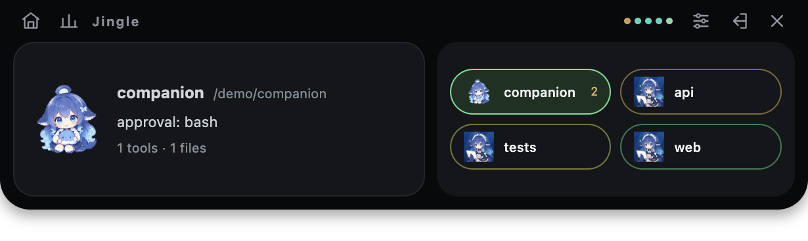
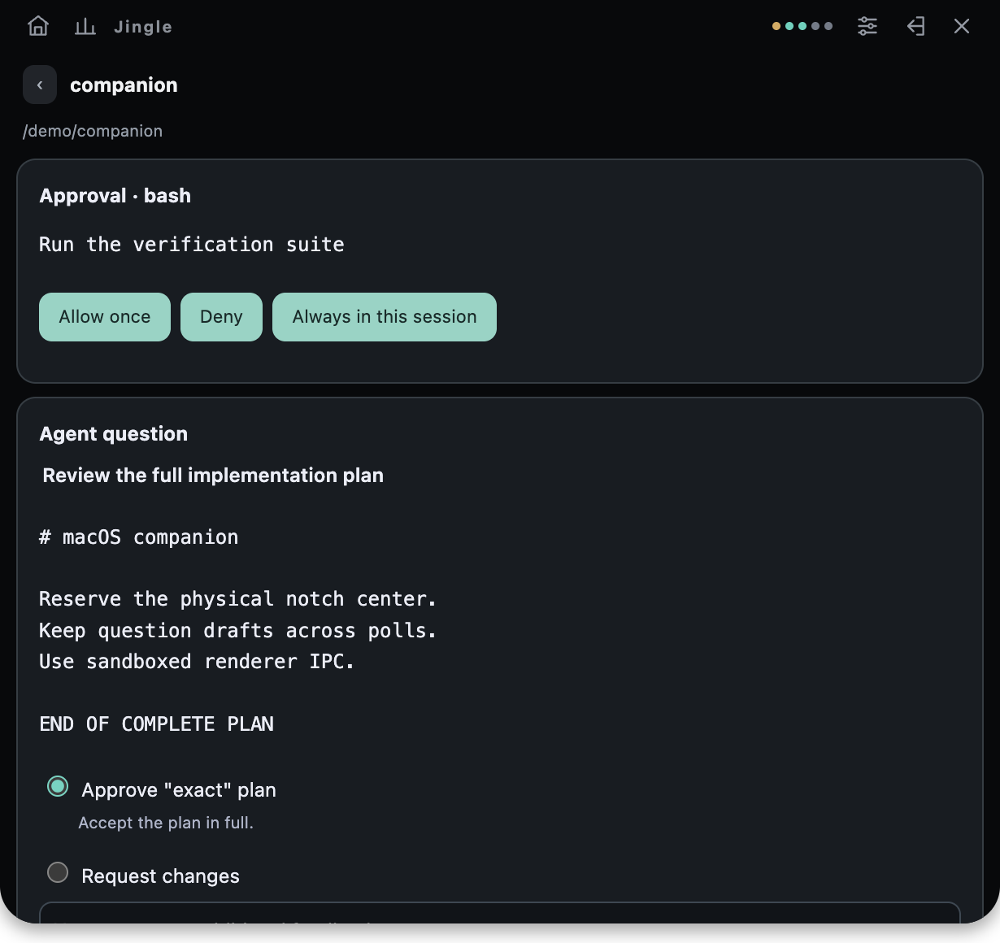

<p align="center">
  
</p>

<h1 align="center">JingleNotch</h1>
<p align="center"><strong>让 AI Agent 的待办决策出现在 Mac 刘海</strong><br>鲸铃 Jingle · macOS 刘海伴侣</p>
<p align="center">
  <a href="README.md">English</a> ·
  <a href="https://github.com/5ysy/dsh-jingle-notch">GitHub</a> ·
  <a href="https://www.npmjs.com/package/dsh-jingle-notch">npm</a>
</p>
<p align="center">
  <a href="https://www.npmjs.com/package/dsh-jingle-notch"></a>
  <a href="LICENSE"></a>
  
</p>


AI Agent 工作时，JingleNotch 会把需要你决策的时刻带到 Mac 刘海：工具审批、计划审核和结构化问题都会由鲸铃 Jingle 提醒。你可以在浮窗中查看完整请求并直接回答，保持当前工作流连续进行。

JingleNotch 支持 DeepSeek Harness 桌面版和 Web 版，也提供相同能力的浏览器仪表盘。

## 快速开始

已安装 DeepSeek Harness 后，通过 npm 安装插件到对应的 profile。

### macOS 桌面版

首次使用请先打开一次 DeepSeek Harness，再完全退出应用。运行：

```sh
'/Applications/DeepSeek Harness.app/Contents/Resources/runtime/cli/bin/dsh' \
  plugin --profile desktop add dsh-jingle-notch
```

重新打开应用，在会话中输入 `/jingle overlay`，即可打开鲸铃刘海浮窗。

### Web 版

```sh
dsh plugin --profile web add dsh-jingle-notch
dsh web
```

在会话中输入 `/jingle overlay` 打开浮窗，也可在 Harness 的服务地址后访问 `/jingle` 使用浏览器面板。已经运行的 Web 服务需要重启。

桌面版和 Web 版分别安装到各自的 profile。原生浮窗需要 macOS 和 Electron；首次启动会尝试通过 npm 下载 Electron，需要 Node/npm 和网络。已有 Electron 时可直接指定路径，详见[安装说明](docs/installation.md)。

## 插件功能

- **审批提醒**：查看工具和原因，选择 Allow once、Deny 或 Always in this session。
- **完整计划审核**：阅读完整计划和准确的审核选项，再决定 Agent 是否继续。
- **结构化问答**：支持单选、多选和自由输入，一次提交整组问题；轮询期间保留草稿。
- **多会话总览**：集中查看活跃会话、当前工具、工作区和并行调用，优先显示待处理请求。
- **文件活动预览**：查看文件修改前后预览和增删行统计，快速了解 Agent 的改动。
- **原生 macOS 刘海界面**：悬停查看概览，展开阅读详情，滚动浏览会话，新请求到达时自动聚焦。
- **浏览器仪表盘**：访问 `/jingle`，在浏览器中查看状态、完成审批和问答。
- **本地运行**：动画随包提供；插件无需额外模型请求，也不添加遥测服务。活动历史只保存数字统计，隐私与通知设置见[配置说明](docs/configuration.md)。
- **声音与系统通知**：审批、提问和任务完成时播放提示音，可分别开关并设置自定义声音。
- **鲸铃状态动画**：待机、思考、执行、提醒、完成和错误状态使用随包提供的离线动画，支持减少动态效果。

## 运行效果





截图来自合成测试会话。鲸铃 Jingle 原始动画随插件打包，无需网络即可使用。

## 兼容版本

| 宿主 | 已验证版本 | 验证范围 |
| --- | --- | --- |
| 官方 macOS 桌面版 | `0.2.1-rc.5` | 内置 CLI 安装、打包 Host、原生浮窗 |
| 正式发布 Web 版 | `0.2.1-rc.5` | Web profile、仪表盘、原生浮窗 |
| 源码 Web 版 | `0.2.2-alpha.2` | 源码 Host、仪表盘、原生浮窗 |

插件清单声明兼容 `0.2.1-rc.5` 和 `0.2.2-alpha.2`。原生浮窗需要 macOS、图形桌面和 Electron。Electron 配置及其他安装方式见[安装说明](docs/installation.md)。

## 命令与配置

```text
/jingle                  查看会话状态
/jingle overlay          打开原生刘海浮窗
/jingle overlay stop     关闭浮窗并保持 Harness 运行
```

profile 补丁中的配置 ID 是 `jingle-notch`。完整配置、存储位置和隐私开关见[配置说明](docs/configuration.md)；测试、打包和 Desktop/Web 验证见[开发与验证](docs/development.md)。

## 开发

```sh
pnpm install --frozen-lockfile
pnpm typecheck
pnpm test
pnpm build
npm pack --dry-run
```

## 反馈与贡献

欢迎通过 [Issues](https://github.com/5ysy/dsh-jingle-notch/issues) 反馈问题或提出功能建议，也欢迎提交 Pull Request。报告问题时请附上 macOS、Harness 和插件版本、使用的 Desktop/Web profile，以及可复现步骤；日志和截图请先移除敏感信息。构建、测试和打包步骤见[开发指南](docs/development.md)。

## 许可证与致谢

JingleNotch 使用 [MIT 许可证](LICENSE)。第三方版权和许可见 [THIRD_PARTY_NOTICES.md](THIRD_PARTY_NOTICES.md)。项目基于 [DeepSeek Harness](https://github.com/deepseek-ai/deepseek-harness)，README 展示和包元数据参考了 [dsh-pet](https://github.com/PC2005-cloud/dsh-pet) 与 [dsh-market](https://github.com/dsh-market/dsh-market)。鲸铃 Jingle 素材由项目作者提供，来源和校验值记录在[素材说明](assets/whale/README.md)。
